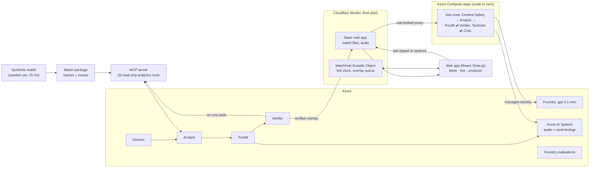

# ChalkTalk

**The AI pundit that draws as it talks.** ChalkTalk turns match tracking data into a studio breakdown. A crew of AI agents picks the moment, measures it with analytics tools, writes and voices a short script, and draws each arrow, line and zone on the pitch at the exact word that names it. Every number on screen links back to the tool call that measured it. Viewers can **ask the pundit** about any moment, typed or spoken: a live agent crew on Azure measures it, checks every number and answers by drawing on the pitch as it speaks.

Built for Microsoft's "Inside the Game" hackathon. All match data is synthetic: the clubs, players and match are made up.

- **Live demo:** https://chalktalk.inspectmate-logs.workers.dev (free, no sign-in)
- **How it works:** [docs/architecture.md](docs/architecture.md) · **Decisions:** [docs/decisions.md](docs/decisions.md)

## Try it in two minutes
1. Open the live demo and press **Watch the studio show**. The first breakdown starts on its own; a short tour explains the screen.
2. Pick a chapter on the left. Watch a stroke land on its word, then **tap a number** in the caption to replay the evidence: the match replays the moment the tool measured, with the tool's own drawing, and shows the check made when the show was built (the tool re-run, same number, same data hash).
3. Switch the **audience** (Casual, Analyst, Newcomer), the **supporter side** (Northbridge, Saltmere, Neutral) or the **language** (English, Español). The crew's chapters are rewritten and redrawn for each. The ghost-run and VAR chapters are drawn straight from their tools' output with a fixed script per language, so they read the same for every audience and side.
4. Open **Live**: the match clock runs on the server and pundit moments air in the pauses. Open **/producer** to approve or reject a moment before it airs. With no producer on shift, the public demo airs the fact-checked moments on auto-pilot and labels them so.
5. In the studio show, type or say a question in **Ask the pundit** (or tap a suggestion such as *What should they have done?*). The live crew on Azure Container Apps answers in about 15 s: the control room shows each agent at work, the Verifier's verdicts and, for a what-if, the Critic keeping or rejecting the Tactician's proposal.

| Feature | Where |
|---|---|
| Strokes land on their words (arrows, gaps, zones, pitch control) | Studio show, any chapter |
| Ask the pundit, typed or spoken: a live crew answers by drawing | Ask bar under the pitch |
| What-if: a Tactician proposes, the sim re-runs it, a Critic keeps it only if the numbers improve | Suggestion "What should they have done?" |
| Control room: each agent, tool call and verdict as it happens | Opens beside a live answer |
| Ghost run: where a player should have been, and what it changes (tool output, fixed script) | Chapter "Where they should have been" |
| VAR offside check: provisional line, then the decision (tool output, fixed script) | Chapter "VAR check: offside?" |
| Evidence replay: tap any number to replay what its tool measured, with the build-time re-run check | Underlined numbers in the caption |
| 18 versions of the show: 3 audiences × 3 sides × 2 languages | Header controls |
| Half-time panel and "Catch me up" summary | Left rail, and the Catch me up button |
| Follow one player ("My player") | Tap a player, or pick one in the header |
| Live broadcast with score bug, xG momentum and goal banner | Live |
| Producer console: review every version, approve or reject | `/producer` |
| 2D chalkboard or 3D broadcast view | View switch (3D needs WebGL2) |

Shareable starting points: `/?surface=show&lens=analyst&side=away`, `/?surface=show&lens=newcomer&side=home&lang=es-ES`, `/?surface=broadcast`, `/producer`.

## How it works


- **Facts come from tools, never from the model.** Distances, gaps, xG and pitch control are computed by deterministic Python tools. The language model only picks, phrases and orders. Each spoken number is bound to its `tool_call`, and the Verifier re-runs the tools before an overlay is released.
- **Strokes are timed to words.** Azure AI Speech returns the audio with word boundaries and SSML bookmarks. Each drawing cue is snapped to the start of its word, so a stroke begins as its word is spoken.
- **Four agents** (Director, Analyst, Pundit, Verifier) run on Foundry Agent Service through Microsoft Agent Framework. They made every crew chapter of the shipped show (the ghost-run and VAR chapters are drawn from tool output with a fixed script); each role has an in-process fallback, which this run never needed.
- **Live answers.** Asked questions go to a second crew on Azure Container Apps: Prompt Shields screen the question, the Analyst picks its own tools, the Pundit drafts, the Verifier sends back any claim whose number does not match a tool result, and for "what should they have done?" a Tactician proposes player moves that the `what_if` tool re-simulates while a Critic keeps them only if the measured numbers improve. The answer streams to the browser as NDJSON and is drawn as it is spoken.
- **Cheap by design.** Tracking frames and audio are precomputed into static files. Servers carry only low-rate control messages, so the live site runs on Cloudflare's free plan.

## Microsoft and Azure technology
| Technology | What it does in ChalkTalk |
|---|---|
| Microsoft Foundry: `gpt-4.1-mini` (pay per token, 20K TPM cap) | Writes the Director's picks, the Pundit's scripts and the Verifier's checks, and the live answers |
| Foundry Agent Service + Microsoft Agent Framework | Hosts the show agents (`chalktalk-director`, `-analyst`, `-pundit`, `-verifier`) and the live ask agents (Analyst with open tool choice, Pundit, Tactician) |
| Foundry evaluations | Three custom evaluators (claim groundedness, numeric tolerance, cue timing) plus the built-in `GroundednessEvaluator` |
| Azure AI Speech (neural voices, en-GB and es-ES) | Voices every chapter and returns the word timings the drawing follows |
| Model Context Protocol (MCP) | The Analyst's 26 analytics tools, served over stdio or streamable HTTP |
| Azure Container Apps | Runs the live ask crew (`chalktalk-ask`), consumption plan, scales to zero; reaches Foundry with a user-assigned managed identity. Bicep templates in `infra/` |
| Azure AI Content Safety | Prompt Shields and text analysis screen every question before an agent runs |
| Azure Monitor OpenTelemetry | Each live answer carries a Foundry trace id |
| GitHub Actions and GHCR | CI on every push; the MCP server and ask crew images |

## Measured
| What | Result | Source |
|---|---|---|
| Stroke start vs its word (speech side) | Each cue snapped to its word start; 0 ms gap enforced on every shipped cue | [c-s1-word-timing](docs/notes/c-s1-word-timing.md), [c-real-audio](docs/notes/c-real-audio.md) |
| Stroke start vs audio (browser side, 33 strokes) | median 10 ms, p95 16 ms | [a-audio-sync](docs/notes/a-audio-sync.md) |
| Claims verified in the shipped show | 198 of 198; all 90 chapters passed the gate | `web/public/fixtures/show-sim-7.json` |
| Evidence re-runs that match the claim (at build) | 14 of 14 | same file |
| Foundry evaluation of the shipped show (54 show overlays + 10 test items) | groundedness 1.0, numeric tolerance 1.0, cue timing 1.0, LLM groundedness 4.98 / 5 | [evals/results](evals/results/2026-10-25-foundry.json) |
| Cost to make the whole show on Foundry agents (54 overlays, 170 agent runs, 0 agent fallbacks; 3 of 54 scripts from the rule-based writer after a failed rewrite) | about $0.06 in tokens; speech on the free tier | [coord-believable-moments](docs/notes/coord-believable-moments.md) |
| Live ask eval, 78 questions (13 moments × views × en-GB/es-ES) | 77 of 78 answered with a drawn overlay, all passing the gate (1 hit the deadline); Verifier rejected 8 of 156 first-round claims; Critic accepted 6 of 34 what-if proposals | [coord-ask-eval](docs/notes/coord-ask-eval.md) |
| Foundry LLM judge of those answers | groundedness 4.62 / 5 (95% pass), relevance 4.23 / 5 (100% pass), after the Pundit label fix (first run: 4.28 and 4.10) | [evals/results](evals/results/2026-10-25-ask-live.json) |
| Live ask speed and cost | answer ready median 12.5 s, p90 18.3 s; about $0.002 per answer | same note |
| Attack questions (prompt injection, phishing, hate) | 6 of 6 ended safely: 2 refused by Prompt Shields, 3 declined by the Pundit, 1 ignored and answered the football | same note |
| Simulated match vs real football | shots 23.7 per 90 (Premier League 25–27); pressing 0.50 (tracking reference 0.48–0.64) | [b-sim-realism](docs/notes/b-sim-realism.md) |
| Tests | 400+ (Python, web, worker, contracts); CI runs on every push | `.github/workflows/` |

## Synthetic data
The match comes from our own seeded simulator. Real open data is used only to calibrate it, and none of it is shipped or shown: IDSSE tracking data (CC BY 4.0) for movement and pressing, and Wyscout open event data (CC BY 4.0) for a three-coefficient xG model. See [docs/data-credits.md](docs/data-credits.md).

## Run it locally (free, no cloud keys)
```bash
uv sync && npm ci
uv run python -m chalktalk_sim generate --seed 7 --half-minutes 5 --demo --out ./packages
uv run python -m chalktalk_crew run --half-minutes 3      # fake LLM and speech, cached overlays
npm run build --workspace web
CHALKTALK_PACKAGES=$PWD/packages npm run dev --workspace workers/edge   # http://localhost:8787
```

Tests: `uv run pytest && npm test`. Tests and CI use fake model and speech clients; live Azure calls happen only in manual runs, with token caps and cached outputs.

## Layout
| Path | What |
|---|---|
| `contracts/` | JSON Schemas (source of truth), generated Pydantic and TypeScript types |
| `core/` `sim/` `mcp/` | Geometry and analytics, the match simulator, the MCP tool server (Python) |
| `crew/` `postmatch/` `evals/` | Agent crew and speech, show building, Foundry evaluations (Python) |
| `vision/` | Experimental: events detected from rendered video (offline, local GPU) |
| `workers/edge/` | Cloudflare Worker: web assets, API, `MatchHub` Durable Object (TypeScript) |
| `web/` | React app, 2D and 3D pitch |
| `infra/` | Azure Bicep |

Contributors and build sessions should read [CLAUDE.md](CLAUDE.md) first.

## Licence
MIT. Data credits are in [docs/data-credits.md](docs/data-credits.md).
