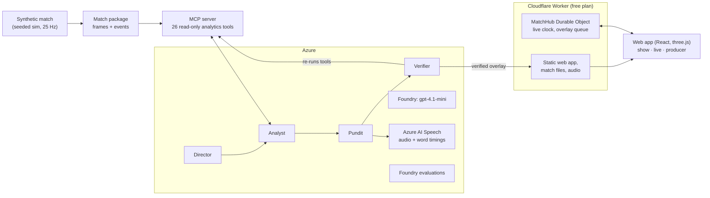

# ChalkTalk

**The AI pundit that draws as it talks.** ChalkTalk turns match tracking data into a studio breakdown. A crew of AI agents picks the moment, measures it with analytics tools, writes and voices a short script, and draws each arrow, line and zone on the pitch at the exact word that names it. Every number on screen links back to the tool call that measured it.

Built for Microsoft's "Inside the Game" hackathon. All match data is synthetic: the clubs, players and match are made up.

- **Live demo:** https://chalktalk.inspectmate-logs.workers.dev (free, no sign-in)
- **How it works:** [docs/architecture.md](docs/architecture.md) · **Decisions:** [docs/decisions.md](docs/decisions.md)

## Try it in two minutes
1. Open the live demo and press **Watch the studio show**. The first breakdown starts on its own; a short tour explains the screen.
2. Pick a chapter on the left. Watch a stroke land on its word, then **tap a number** in the caption to replay the evidence: the tool re-runs and the match replays the moment it measured.
3. Switch the **audience** (Casual, Analyst, Newcomer), the **supporter side** (Northbridge, Saltmere, Neutral) or the **language** (English, Español). The same moment is rewritten and redrawn for each.
4. Open **Live**: the match clock runs on the server and pundit moments air in the pauses. Open **/producer** to approve or reject a moment before it airs.

| Feature | Where |
|---|---|
| Strokes land on their words (arrows, gaps, zones, pitch control) | Studio show, any chapter |
| Ghost run: where a player should have been, and what it changes | Chapter "Where they should have been" |
| VAR offside check: provisional line, then the decision | Chapter "VAR check: offside?" |
| Evidence replay: tap any number to re-run its tool | Underlined numbers in the caption |
| 18 versions of the show: 3 audiences × 3 sides × 2 languages | Header controls |
| Half-time panel and "Catch me up" summary | Left rail, and the Catch me up button |
| Follow one player ("My player") | Tap a player, or pick one in the header |
| Live broadcast with score bug, xG momentum and goal banner | Live |
| Producer console: review every version, approve or reject | `/producer` |
| 2D chalkboard or 3D broadcast view | View switch (3D needs WebGL2) |

Shareable starting points: `/?surface=show&lens=analyst&side=away`, `/?surface=show&lens=newcomer&side=home&lang=es-ES`, `/?surface=broadcast`, `/producer`.

## How it works


- **Facts come from tools, never from the model.** Distances, gaps, xG and pitch control are computed by deterministic Python tools. The language model only picks, phrases and orders. Each spoken number is bound to its `tool_call`, and the Verifier re-runs the tools before an overlay is released.
- **Strokes are timed to words.** Azure AI Speech returns the audio with word boundaries and SSML bookmarks. Each drawing cue is snapped to the start of its word, so a stroke begins as its word is spoken.
- **Four agents** (Director, Analyst, Pundit, Verifier) run on Foundry Agent Service through Microsoft Agent Framework. The shipped show was made by them end to end; each role has an in-process fallback, which this run never needed.
- **Cheap by design.** Tracking frames and audio are precomputed into static files. Servers carry only low-rate control messages, so the live site runs on Cloudflare's free plan.

## Microsoft and Azure technology
| Technology | What it does in ChalkTalk |
|---|---|
| Microsoft Foundry: `gpt-4.1-mini` (pay per token, 20K TPM cap) | Writes the Director's picks, the Pundit's scripts and the Verifier's checks |
| Foundry Agent Service + Microsoft Agent Framework | Hosts the four agents (`chalktalk-director`, `-analyst`, `-pundit`, `-verifier`) |
| Foundry evaluations | Three custom evaluators (claim groundedness, numeric tolerance, cue timing) plus the built-in `GroundednessEvaluator` |
| Azure AI Speech (neural voices, en-GB and es-ES) | Voices every chapter and returns the word timings the drawing follows |
| Model Context Protocol (MCP) | The Analyst's 26 analytics tools, served over stdio or streamable HTTP |
| Azure Container Apps (Bicep) | Deployment template for the MCP server, consumption plan, scales to zero |
| GitHub Actions and GHCR | CI on every push; the MCP server image |

## Measured
| What | Result | Source |
|---|---|---|
| Stroke start vs its word (speech side) | Each cue snapped to its word start; 0 ms gap enforced on every shipped cue | [c-s1-word-timing](docs/notes/c-s1-word-timing.md), [c-real-audio](docs/notes/c-real-audio.md) |
| Stroke start vs audio (browser side, 33 strokes) | median 10 ms, p95 16 ms | [a-audio-sync](docs/notes/a-audio-sync.md) |
| Claims verified in the shipped show | 198 of 198; all 90 chapters passed the gate | `web/public/fixtures/show-sim-7.json` |
| Evidence re-runs that match the claim | 14 of 14 | same file |
| Foundry evaluation of the shipped show (54 show overlays + 10 test items) | groundedness 1.0, numeric tolerance 1.0, cue timing 1.0, LLM groundedness 4.94 / 5 | [evals/results](evals/results/2026-10-24-foundry.json) |
| Cost to make the whole show on Foundry agents (54 overlays, 176 agent runs, 0 fallbacks) | about $0.06 in tokens; speech on the free tier | [coord-foundry-show](docs/notes/coord-foundry-show.md) |
| Simulated match vs real football | shots 23.7 per 90 (Premier League 25–27); pressing 0.50 (tracking reference 0.48–0.64) | [b-sim-realism](docs/notes/b-sim-realism.md) |
| Tests | 400+ (Python, web, worker, contracts); CI runs on every push | `.github/workflows/` |

## Synthetic data
The match comes from our own seeded simulator. Real open data is used only to calibrate it, and none of it is shipped or shown: IDSSE tracking data (CC BY 4.0) for movement and pressing, and Wyscout open event data (CC BY 4.0) for a three-coefficient xG model. See [docs/data-credits.md](docs/data-credits.md).

## Run it locally (free, no cloud keys)
```bash
uv sync && npm ci
uv run python -m chalktalk_sim generate --seed 7 --half-minutes 5 --demo --out ./packages
uv run python -m chalktalk_crew run --half-minutes 3      # fake LLM and speech, cached overlays
npm run build --workspace web
CHALKTALK_PACKAGES=$PWD/packages npm run dev --workspace workers/edge   # http://localhost:8787
```

Tests: `uv run pytest && npm test`. Tests and CI use fake model and speech clients; live Azure calls happen only in manual runs, with token caps and cached outputs.

## Layout
| Path | What |
|---|---|
| `contracts/` | JSON Schemas (source of truth), generated Pydantic and TypeScript types |
| `core/` `sim/` `mcp/` | Geometry and analytics, the match simulator, the MCP tool server (Python) |
| `crew/` `postmatch/` `evals/` | Agent crew and speech, show building, Foundry evaluations (Python) |
| `vision/` | Experimental: events detected from rendered video (offline, local GPU) |
| `workers/edge/` | Cloudflare Worker: web assets, API, `MatchHub` Durable Object (TypeScript) |
| `web/` | React app, 2D and 3D pitch |
| `infra/` | Azure Bicep |

Contributors and build sessions should read [CLAUDE.md](CLAUDE.md) first.

## Licence
MIT. Data credits are in [docs/data-credits.md](docs/data-credits.md).
