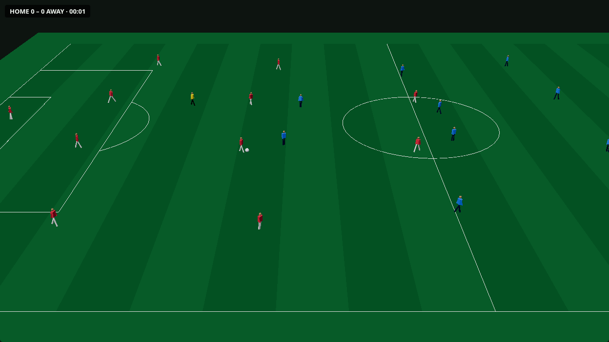
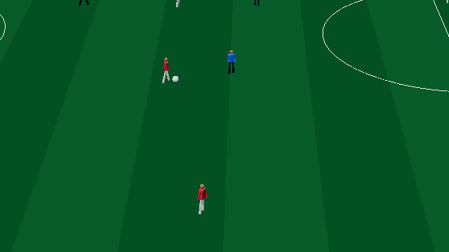

# Spike S3: broadcast-distance figures (stream A)

Close crop of the same frame: 

Both are from headless Chromium (SwiftShader) against `vite preview`, `/?match=e2e-no-hub&view=3d`, 1280×860, the light path.

## What shipped
- **Opt-in 3D view.** The 2D SVG board stays the default, because it is the GPU-light path. `?view=3d` or the header's **View** toggle opens the broadcast view.
  - `?quality=high` adds antialiasing, shadows and a pixel ratio of up to 2.
  - The light path has no shadows and no antialiasing, uses Lambert materials, caps the pixel ratio at 1.5 and asks for a `low-power` GPU.
- **Breakdowns cut to the 2D chalkboard.** When an overlay is active, the view cuts to the 2D board, as a broadcast cuts to its telestrator, then returns to 3D. The canvas stays mounted but stops rendering (`frameloop="never"`) while hidden. Strokes are not drawn in 3D yet.
- **Lazy chunk.** `web/src/figures/Broadcast3D.tsx` loads with `React.lazy`, so three.js is fetched only when 3D is first opened.

  | chunk | size | gzip |
  | --- | --- | --- |
  | main `index-*.js` (unchanged by this PR) | 401 kB | 124.6 kB |
  | `Broadcast3D-*.js` (three + @react-three/fiber), lazy | 931 kB | 251 kB |

  Vite warns about the lazy chunk's size. r3f's `Canvas` pulls in the whole three namespace, so tree-shaking can't help much. A later cut could drop r3f for plain three, but that would also need three's per-module imports to shrink.
- **Draw calls.** Figures are procedural, with one `InstancedMesh` per body part (torso, head, legs, arms), and team colours come from `instanceColor`. That is 4 draw calls for all 23 people. The pitch, stripes, lines and ball add the rest. The view rendered at a steady 60 fps on SwiftShader (software GL), so real GPUs have headroom.
- **Camera.** An elevated side camera (30 m up, 70 m back, 30° FOV) frames both touchlines and pans with the ball's x.

## Quaternius or procedural
I chose lean procedural figures. Quaternius CC0 characters are rigged glTF files that need a skinned mesh per player, plus an `AnimationMixer` and clip blending. That is more download and more CPU per frame, and it adds an asset-fetch dependency. At broadcast distance a player is about 25–40 px tall, so a skinned mesh adds little you can see. I did not measure the Quaternius pack size. The swap stays open: `gait.ts` already gives the clip, phase and foot plants that a rigged model would need.

## Gait: clip from speed and heading, no foot sliding (`web/src/figures/gait.ts`)
- **Clip from speed `v`:**
  - idle below 0.3 m/s
  - walk below 2.2 m/s
  - jog below 5 m/s
  - sprint otherwise

  The stride is 0.8 / 1.4 / 2.2 / 3.6 m per cycle.
- **Facing** comes from the gap between `heading` (travel) and `body_heading`. Under 60° is forward, over 120° is backpedal, and anything between is a side-step. The facing turns the torso and hips, sets the lean and damps the arm swing. The feet always step along the travel direction, and each leg hooks to whichever hip is nearer, so backpedalling legs don't cross.
- **No foot sliding, by construction:**
  - The gait phase advances with the ground actually covered between frames (`distance / stride`), not with time.
  - A foot lands half a step ahead of the pelvis and stays at that exact pitch point for its whole stance. The swing foot travels from its lift-off point to the next landing point.
  - A clip change mid-stride can't drag a planted foot, because the plant is stored and not recomputed from the phase.
- **Seeks.** A held frame (Δt = 0) keeps the pose. Going backwards in time, a gap over 500 ms or a jump over 5 m starts a fresh pose.
- **Tests (`web/test/gait.test.ts`).** For walk, jog, sprint, backpedal and side-step, every planted foot stays exactly still from frame to frame. Steps keep pace with distance (plants ≈ distance / stride ± 1). The held-frame and seek resets are tested too.

## Not covered
- **Interpolation.** Frames play at 25 fps without interpolation, so the bodies move in 40 ms steps while the feet stay planted. Interpolating between frames is a small follow-up.
- **Figure detail.** There are no shirt numbers, goalkeeper kits or player-to-player collisions. Kits are generic synthetic red, blue and yellow.
- **Performance on real devices.** I have not measured the 3D view on a low-end phone. The 2D board stays the default for that reason.
